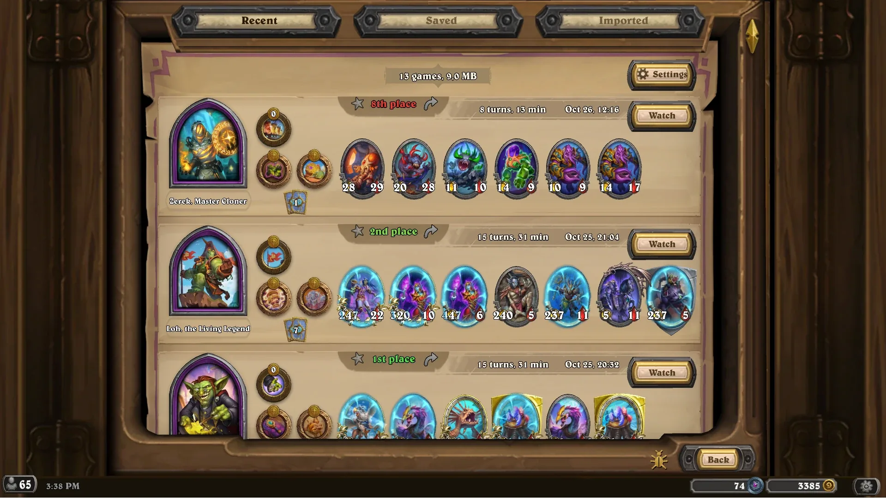
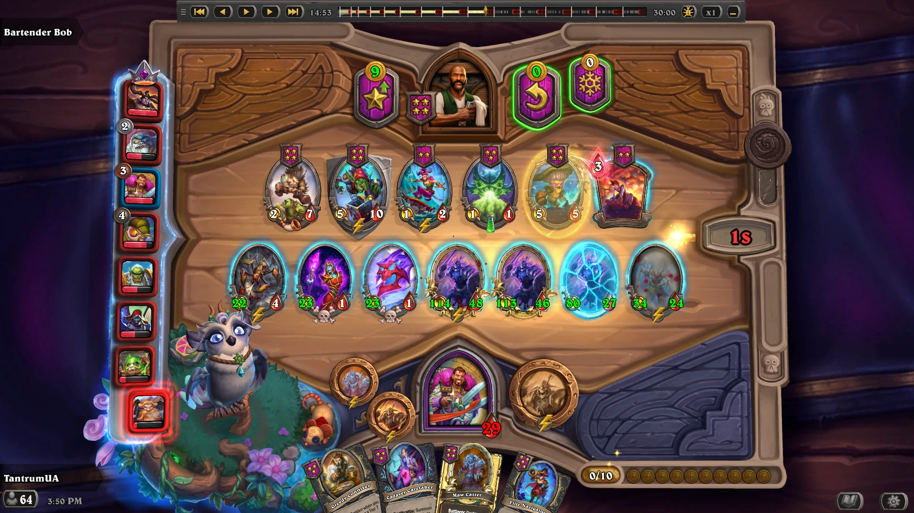
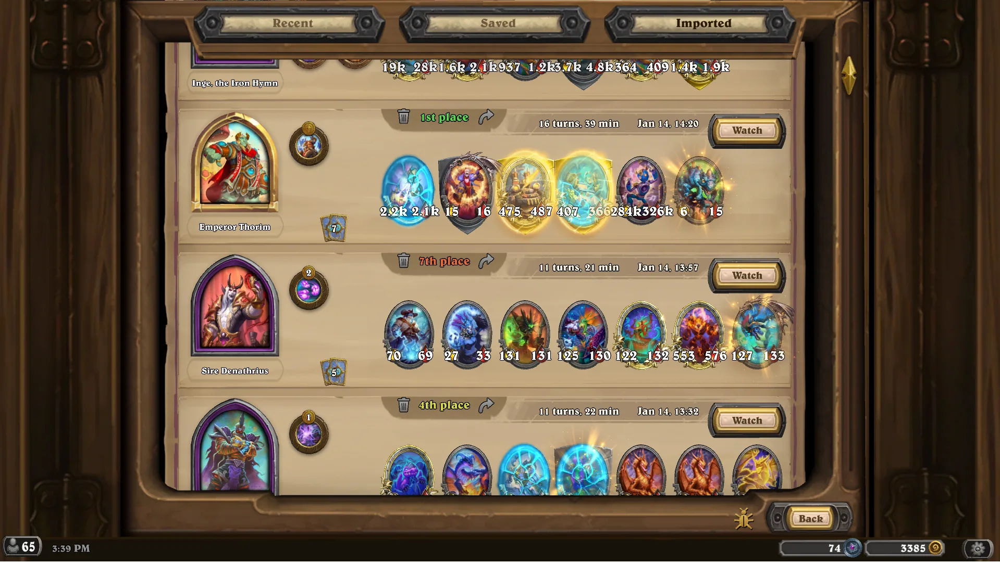
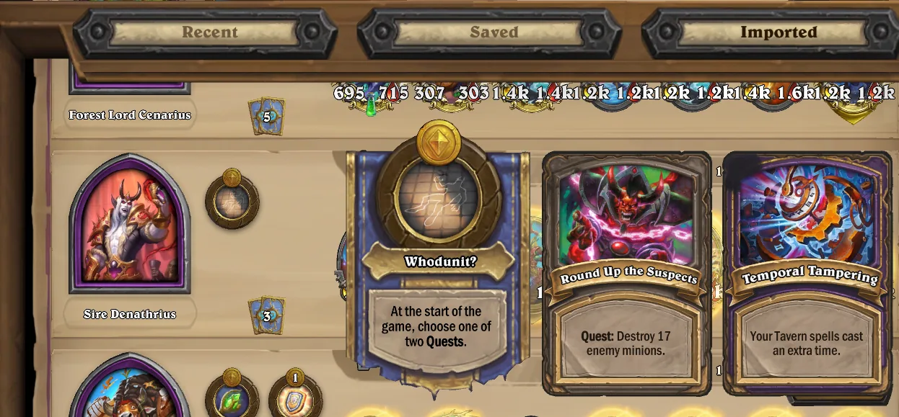

# HS Replay Watcher

Watch your Hearthstone Battlegrounds games again, inside the game. Every game you play is recorded, and the
**Replays** page in the Battlegrounds lobby plays any of them back in the real client: jump to any moment, step
through a fight, or watch at up to x4.

**Beta.** Expect rough edges, and please report them: the bug button opens a
[bug report](../../issues) with the details already filled in.

- **Replays page:** one card per game — hero, hero powers, trinkets, final board and hand, place, date and
  length. Hover an icon to read it as it ended the game. **Watch** plays the game back.
- **Replay bar:** previous/next event and turn, pause, speed, and a timeline of the whole game with its fights
  marked. Drag it anywhere or shrink it to its buttons; **F10** hides it.
- **Keys:** **Space** pause · **←/→** event · **Ctrl+←/→** turn · **Enter/Backspace** one step · **+/−** speed.
- **Recent, Saved and Imported**, as tabs in the page's title. The **star** keeps a game in a folder of your own,
  outside the Hearthstone folder, where updates and reinstalls can't reach it.
- **Share** a game with the arrow next to its place: it lands on your clipboard as a file. **Ctrl+V** on the
  Replays page takes one back, as does **Import**, which also reads a `Power.log` from Hearthstone's `Logs`.

## Install

Download `HSReplayWatcher-Setup-<version>.exe` from [Releases](../../releases), close Hearthstone and run it.
Windows may warn about an unknown publisher (the setup isn't signed): choose **More info → Run anyway**. Then
start Hearthstone from Battle.net as usual.

The setup brings [BepInEx](https://github.com/BepInEx/BepInEx), the mod loader, if your Hearthstone doesn't have
it yet; one that's already there is left as it is. **Windows, Hearthstone for PC** (made for patch 37.0).

No **Replays** button? Check that `BepInEx\LogOutput.log` in your Hearthstone folder contains
`HS Replay Watcher loaded`. After a Hearthstone patch the watcher can stop working until it's updated.

## Reporting a bug

Click the bug on the replay bar, or left of **Back** on the Replays page. It takes a screenshot, opens a
pre-filled issue (you need a GitHub account) and puts the files to attach in a folder: press **Ctrl+V** in the
issue to paste the screenshot, drag the game and the logs in from the folder, and say what went wrong.

Nothing leaves your PC on its own — the bug button only opens a page in your browser. A game you share or attach
is a copy with your account's session passwords and your PC's name and device id removed, and it replays exactly
as yours does; a file you import is checked line by line, and only a clean copy rebuilt from it is kept.

## Uninstall

Windows Settings → Apps → HS Replay Watcher → Uninstall. BepInEx goes too, unless another mod still uses it or it
was there before. Your games stay in the folder you chose (or in `%LOCALAPPDATA%\HS Replay Watcher` if you never
chose one); delete it to remove them as well.

## About

An unofficial, client-side mod, not supported by Blizzard. It records a game by keeping a copy of the messages
between the game server and your client, and plays a replay from a small server on your own PC; it never changes
a live match.

Copyright 2026 TantrumUA(RTantrumR). Licensed under the [Apache License 2.0](LICENSE); see [NOTICE](NOTICE).
Hearthstone's art, fonts and text that the watcher shows stay Blizzard's: they're loaded from your own
installation, and the license doesn't cover them. Built on [BepInEx](https://github.com/BepInEx/BepInEx) and
[HarmonyX](https://github.com/BepInEx/HarmonyX), with Python's embeddable package for the replay server.

Not affiliated with or endorsed by Blizzard Entertainment. Hearthstone is a trademark of Blizzard
Entertainment, Inc.
